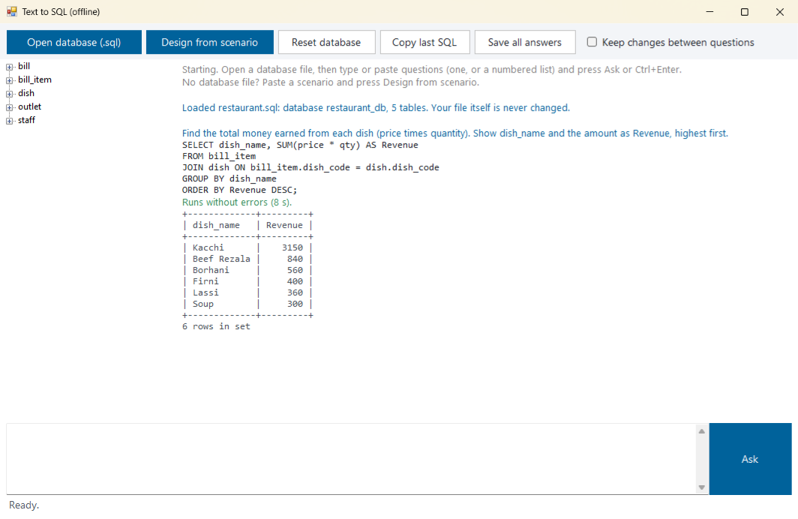
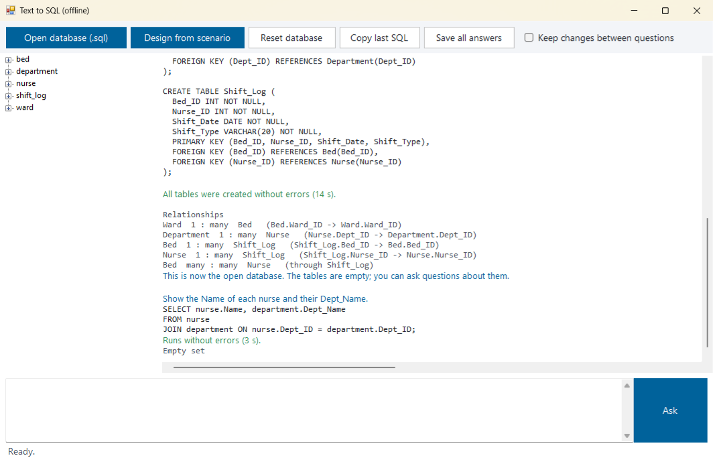
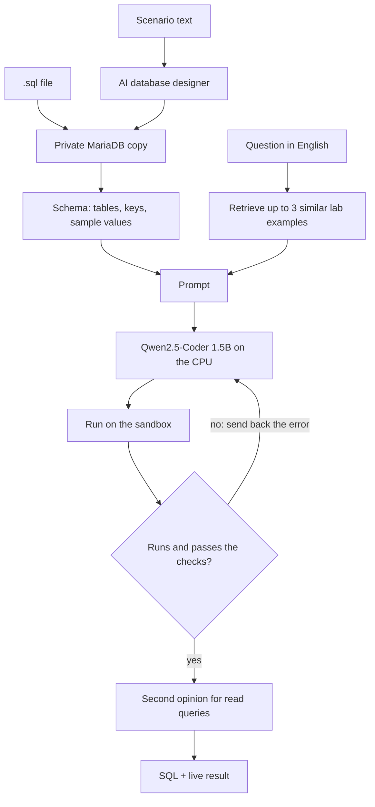

# ⚡ TEXTtoSQL

### A complete AI database lab on a pendrive. No internet. No GPU. No installation. Runs on a 4 GB RAM PC.

Plug it in. Open a `.sql` file. Ask in plain English. A neural network running **on that machine's own CPU** writes the
SQL, **executes it on a real database**, checks it, tries to fix its own mistakes, and shows you the answer.

No `.sql` file? Paste a scenario and it **designs the database for you**.

## 📸 See it in action

**Ask in English: the app writes the SQL, runs it and shows the result**

**Design from scenario: text in, tested tables and relationships out**

## 🎯 The problem

AI can write SQL, but the usual tools need an internet connection, an account or powerful hardware. Many university lab
PCs have none of those: 4 GB of RAM, no GPU, and no right to install anything. And a plain chatbot hands you SQL that it
has **never run**.

**TEXTtoSQL puts the AI model, the database engine and the testing loop into one folder of about 1 GB.**

## 🚀 What it does

| Feature | How it helps |
|---|---|
| 💬 **English to SQL** | Queries, joins, subqueries, updates, views, triggers, procedures and functions |
| 🧪 **Runs before it answers** | The SQL is executed on a private copy; your file is never changed |
| 🔁 **Self-correction** | Database errors and failed checks go back to the model, up to 3 tries in total |
| 🗳️ **Second opinion** | Drafts of a read query are compared by their *results*, and disagreement is flagged |
| 🏗️ **Design from scenario** | Text in; tested tables, keys and relationships out |
| 📚 **Knows the course** | Learns from 81 lab examples at question time; add your own in a text file |
| 📋 **Batch mode** | Paste a whole numbered question sheet |
| 🔒 **Private** | Your data and questions stay on the PC |

## 🧠 How it works

1. **Sandbox.** A portable MariaDB server starts on a throwaway data folder, reached through a named pipe with its
   network port turned off. Everything is deleted on exit.
2. **Schema.** Tables, keys, likely undeclared links and sample values become compact text. For large databases, only
   the tables that match the question are kept.
3. **Retrieval.** A TF-IDF-style search finds the closest lab examples. Clashing table names are disguised so the model
   copies the technique and not the columns.
4. **Generation.** A 4-bit transformer writes the SQL through llama.cpp.
5. **Verification.** The SQL is executed with time limits, then rule checks look for missing aliases, wrong operators,
   missing sorting, unused columns, or a `SELECT` where a change was asked for.
6. **Repair.** The exact database error, plus the columns that really exist, goes back to the model.

### Design from scenario

The model proposes tables, then ordinary code takes over: it sorts parents before children, quotes reserved words such
as `Order`, builds everything with foreign key checks **on**, and looks for missing fields, missing primary keys,
undeclared links, and junction keys that would block repeated events.

## 💻 How it fits in 4 GB

Tested on a real 4 GB RAM Windows 11 PC. Every part was chosen or tuned to be small:

| Part | Technique | Memory while developing |
|---|---|---|
| AI model | 1.5B weights quantized to 4 bits: from 3.1 GB to **986 MB** | about 1.2 GB |
| Database | MariaDB with a 24 MB buffer pool and unused features off | about 60 MB |
| App | One native Windows program of about 100 KB | about 60 MB |

- **Survives slow pendrives:** the model is read into RAM once, so answering never waits on USB.
- **Adapts to the processor:** 14 CPU builds ship in the folder, and llama.cpp loads the one that suits the machine.
- **Reuses work:** the prompt cache avoids reading the same schema again for each question.
- **Cleans up:** a Windows Job Object ends the AI and database processes even if the app crashes or the drive is pulled.

## 🛠️ Tech stack

| Layer | Technology |
|---|---|
| **App** | C# 5, .NET Framework, WinForms: about 1,000 lines, compiled with the compiler that ships with Windows |
| **AI model** | Qwen2.5-Coder 1.5B Instruct, GGUF Q4_K_M |
| **Inference** | llama.cpp `llama-server`, CPU only, streaming over localhost |
| **Database** | Portable MariaDB 10.11 |
| **Retrieval** | Custom TF-IDF-style search with stemming |
| **Training** | Python 3.11, PyTorch (CUDA 12.6), Transformers, PEFT/LoRA |
| **Data** | pandas, PyArrow, PyMySQL, with execution checks on MariaDB |
| **Training GPU** | NVIDIA RTX 4050 Laptop, 6 GB |
| **Testing** | Python benchmark that compares results, plus Windows UI automation |

## 🔬 The experiment: training a neural network on a laptop

**Could a 1.5-billion-parameter model be trained on lab-style SQL with a 6 GB laptop GPU, and would it beat the system
already built?**

| | |
|---|---|
| **Training data** | 8,319 examples, with **every SQL answer executed on MariaDB** before it was accepted |
| **Sources** | 4,203 generated from randomised databases + 4,116 public ([gretelai](https://huggingface.co/datasets/gretelai/synthetic_text_to_sql), Apache-2.0) |
| **Method** | LoRA: 18.5M trainable weights, 1.2% of the model |
| **Fitting in 6 GB** | bfloat16, gradient checkpointing, and output scores computed only for answer tokens |
| **Training** | 507 steps in about an hour, at about 4.1 GB of GPU memory |
| **Validation loss** | **0.578 → 0.123** |
| **Deployment** | Merged, quantized to 986 MB, and run in the real app |

Then both models faced the same app and the same 80 graded questions on 5 databases. An answer passes only if its
**results** match the reference; running without errors is not enough.

| Test set | Original | Fine-tuned |
|---|---|---|
| lab6 | 13/14 | 13/14 |
| company | 11/16 | **12/16** |
| hospital | **18/18** | 16/18 |
| library | 10/12 | **11/12** |
| restaurant (new questions) | 14/20 | 14/20 |
| **Total** | **66/80 (82.5%)** | **66/80 (82.5%)** |
| Mean time per question* | 6.6 s | **4.9 s** |

**What it showed:** training really changed the model. It gained 9 questions, lost 9 others, and answered about 25%
faster. The rule was fixed in advance: replace the original only if the score improves. It tied, so **the app ships the
original model**, and the trained one is the starting point for the next round.

**The whole system** grew from **48/60** to **52/60** on the first benchmark, using fixes to the app around the model.
The original model's SQL ran without errors on 79 of the 80 questions.

* Measured on an i7-13700HX, CPU only, including 10 ungraded questions; a 4 GB PC is slower. Failures on the first
60 questions guided development, so restaurant (14/20) is the fairest estimate.

## 🧩 Hard problems solved

- **A bug you could not see.** An invisible backspace character had replaced `\b` in a regex, silently disabling a check.
- **A trained model that spoke gibberish.** Conversion had set `rope_theta` to 0 instead of 1,000,000. It was traced by
  comparing model files and fixed without retraining.
- **A network that kept resetting.** A resumable downloader brought in the 3 GB model anyway.

## ▶️ How to use

1. Copy the full `TextToSQL` folder to a pendrive and open `TextToSQL.exe`.
2. Click **Open database (.sql)**, or paste a scenario and click **Design from scenario**.
3. Type a question or paste a numbered list, then press **Ask**.

## ⚠️ Know its limits

This is an experimental project with a small model. SQL that runs can still be wrong, complex joins are its weakest
area, and larger designs may miss a link. Check the answers, especially those with an orange warning.

## 📁 Repository

| Folder | Contents |
|---|---|
| `src/` | App source and `build.bat` |
| `pendrive/` | Compiled app and lab examples |
| `eval/` | Benchmarks, reference answers and results |
| `train/` | Data generator, GPU training and comparison scripts |

Too large for GitHub, or third-party: to rebuild, add the GGUF model, llama.cpp and MariaDB to `model/`, `engine/` and
`mariadb/` inside `pendrive/TextToSQL/`. Course documents are not included.

## 👤 Author

**Mohammad Ali Nabil**
